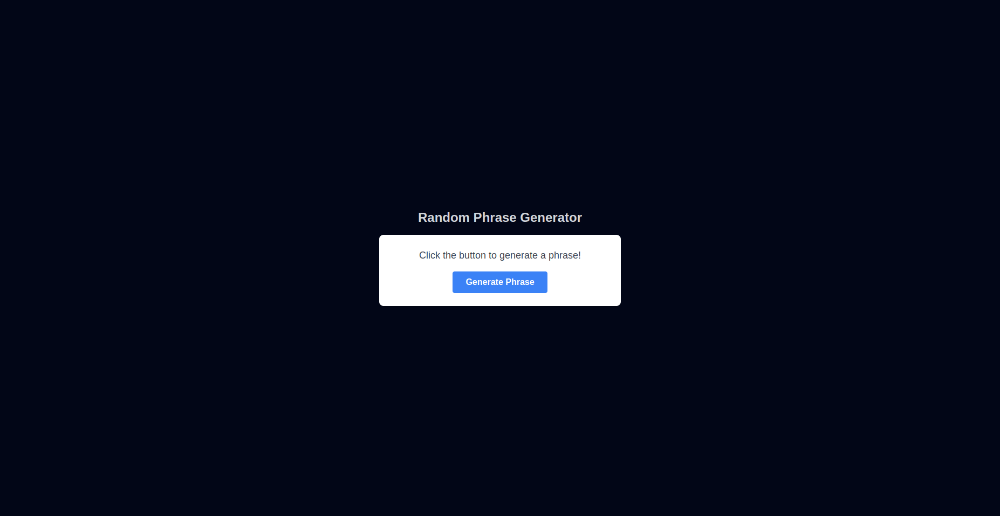
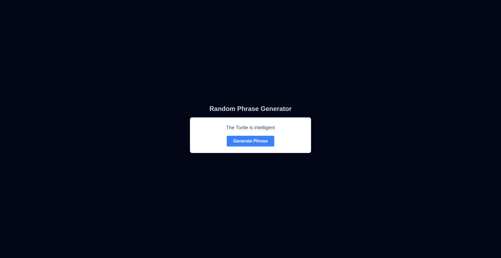

# API Phrasal Generate

This project demonstrates a simple Next.js application which consists of generating random sentences, entirely in containers using Docker. The application provides a user interface in which users can click the button to generate the phrase contained in two arrays and receive the result concatenated with each phrase in both arrays.

## Features

- Getting:
  - Random subject concatenated with random predicate..
  - The subject with an added adjective if the sentence has more than 8 characters.
  - The predicate with a “!” if the sentence contains the word “coding”.
- Intuitive web interface with real-time responses.
- Fully Dockerized for portability and consistency.

## Prerequisites

- Docker version 27.3.1 or higher.
- Docker Compose version v2.29.7 or higher.

## Project Structure

```
api-phrasal-generator/
├── app/                  # Next.js App Directory containing pages and API routes
├── Dockerfile            # Docker configuration for the app
├── next.config.ts        # Next.js configuration file
├── public/               # Static assets
├── tailwind.config.ts    # TailwindCSS configuration
├── tsconfig.json         # TypeScript configuration
└── README.md             # Documentation
```

## Backend and Frontend Explanation

### Backend
- **Type:** Serverless API (via Next.js API Routes).
- **Location:** `app/api/phrases/route.ts`
- **Purpose:** Handles the business logic, including:
  - Analyzing user input.
  - Perform randomly generate sentences (random methods).
  - Returning the results as a JSON response.
- **How it works:** Acts as a stateless function triggered by HTTP requests.

### Frontend
- **Type:** Client-side React Application.
- **Location:** `app/page.tsx`
- **Purpose:**
  - Provides the user interface for click events and results display.
  - Gets the data from the API.
  - Displays the API response (results or errors) in real time.

## How to Install and Run

### Clone this repository:

```bash
git clone https://github.com/ecc97/nextjs-api-phrasal-generator.git
cd next-js-api-phrasal-generator
```

### Build the Docker image:

```bash
docker build -t api-phrase-generator .
```

### Start the container in development mode:

```bash
docker build -t api-phrase-generator .
docker run -p 3000:3000 api-phrase-generator
```

### Access the application:

Open your browser and navigate to:

```
http://localhost:3000
```

## Demo screenshots



---
